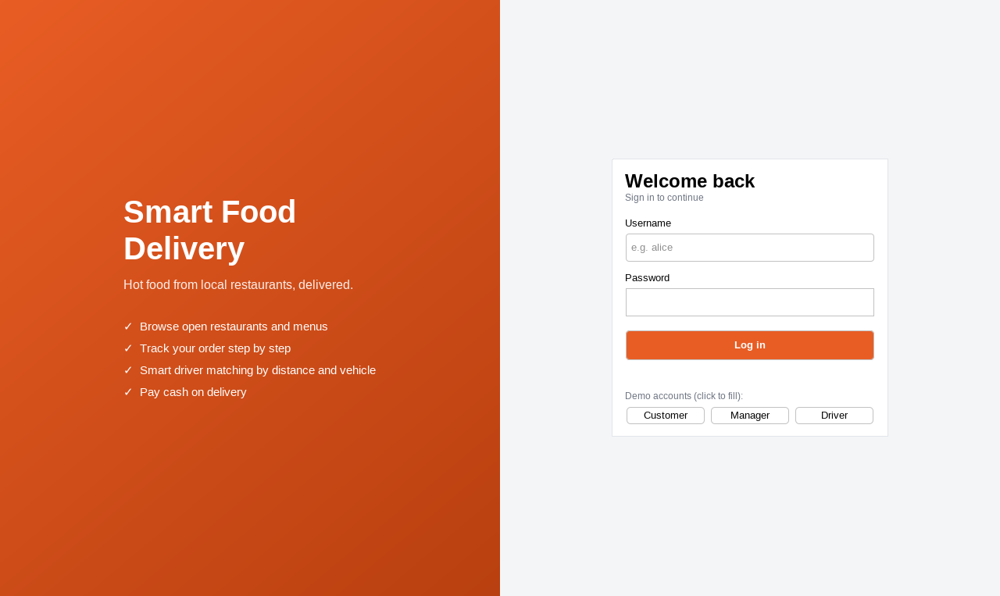
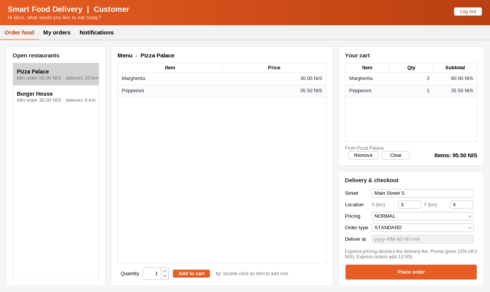
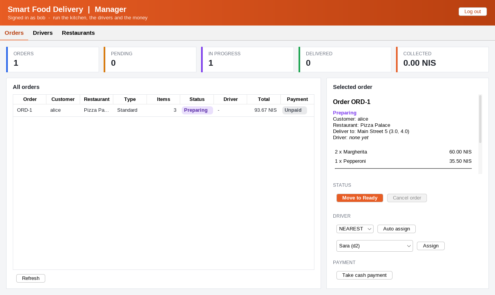
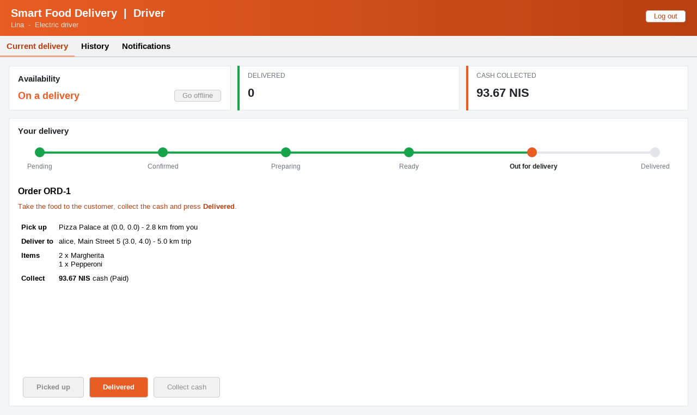
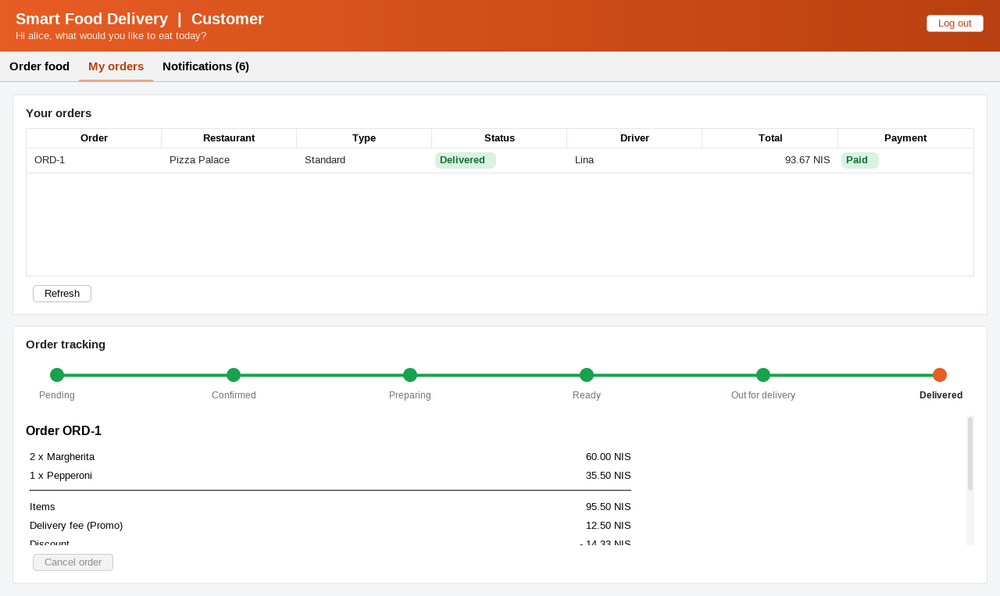
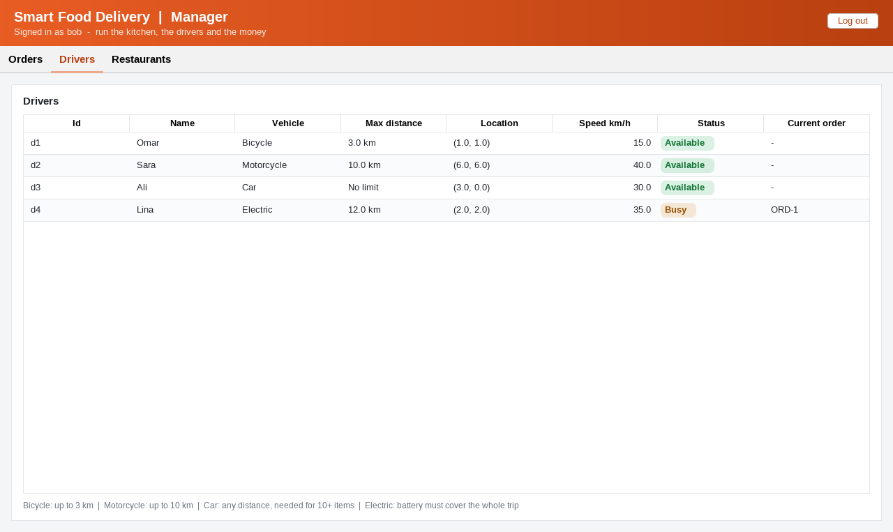

# Smart Food Delivery Management System

Software Engineering (10636313) course project – Phase 1.

Team: khaledmareimed (s12323961), zainsiksik (s12323511)

Java 8+ · Maven · Swing (FlatLaf) · SQLite · JUnit 5 · Mockito · JaCoCo · GitHub Actions

## Run the app

    mvn clean package
    java -jar target/smart-food-delivery-1.0-SNAPSHOT.jar

or `mvn compile exec:java`, or run `com.fooddelivery.Main` from your IDE.

The data is stored in `food_delivery.db` (SQLite) in the folder you run from.
Delete that file to start again with the demo data.

Demo logins (the login screen also has buttons that fill them in):

| User                    | Password    | Role     |
|-------------------------|-------------|----------|
| alice                   | alice123    | Customer |
| bob                     | manager123  | Manager  |
| omar / sara / ali / lina | driver123   | Driver (bicycle / motorcycle / car / electric) |

### Try a full delivery

1. Log in as **alice**, pick a restaurant, add items to the cart and place the order.
2. Log in as **bob**, select the order, press *Move to Confirmed* and *Move to Preparing*,
   then *Auto assign* a driver and *Move to Ready*.
3. Log in as the assigned **driver**, press *Picked up*, *Collect cash* and *Delivered*.
4. Log in as **alice** again: the order is delivered and paid, and the notifications show every step.

## Screens

| Customer | Manager | Driver |
|---|---|---|
|  |  |  |
|  |  | |

## Run the tests with coverage

    mvn clean verify

Coverage report: `target/site/jacoco/index.html`.
The build fails if line or branch coverage drops below 80%.
The Swing screens (`presentation` package) are tested by hand and are not counted.

Mockito is used for the notification service, the payment gateway and the clock (`TimeProvider`).

## Layers

    presentation (Swing)  ->  service  ->  domain
                                  |
                              repository  ->  persistence (SQLite)

## Sprints

- [x] Sprint 1 – Login, open restaurants, available menu items (US1.1–US1.3)
- [x] Sprint 2 – Place order, invalid orders, delivery policies, cancel (US2.1–US2.4) + SQLite
- [x] Sprint 3 – Driver assignment (nearest / fastest), notifications (US3.1–US3.4) + Swing GUI
- [x] Sprint 4 – Order lifecycle, delivery fee, pricing types, cash payment (US4.1–US4.4)
- [x] Sprint 5 – Order types and driver types (US5.1–US5.4)
- [x] Polish – driver role and driver screen, redesigned GUI, UML diagrams

## Business rules

- Delivery fee = 5 + 1.5 per km (restaurant to customer).
- Pricing: NORMAL; PEAK (fee × 1.5, applied automatically 12–14 and 18–21);
  EXPRESS (fee × 2); PROMO (15% off items, max 20).
- Order types: STANDARD; EXPRESS (+10 delivery fee); SCHEDULED (needs a future delivery time).
- Drivers: BICYCLE (≤ 3 km), MOTORCYCLE (≤ 10 km), CAR (any distance, required for 10+ items),
  ELECTRIC (battery range must cover driver → restaurant → customer).
- Lifecycle: Pending → Confirmed → Preparing → Ready → Out for Delivery → Delivered.
  Pending and Confirmed orders can be cancelled (an assigned driver is freed).
  Delivered orders cannot be changed. An order needs a driver before it goes out for delivery.
- Drivers can only pick up and deliver their own orders. A driver with an active delivery cannot go online.

## Documentation

UML diagrams are in `docs/uml` (PlantUML source + PNG + SVG):

| Diagram | File |
|---|---|
| Class diagram | `docs/uml/class-diagram.png` |
| Use case diagram | `docs/uml/use-case-diagram.png` |
| Order lifecycle (state) | `docs/uml/order-state-diagram.png` |
| Layered architecture | `docs/uml/architecture-diagram.png` |
| Database schema | `docs/uml/database-diagram.png` |
| Sequence: place order | `docs/uml/sequence-place-order.png` |
| Sequence: assign driver and deliver | `docs/uml/sequence-delivery.png` |

Fully documented class (Javadoc on the class, every field and every method): `domain/Order.java`.

To re-render the diagrams: `java -jar plantuml.jar -tpng docs/uml/*.puml`.
